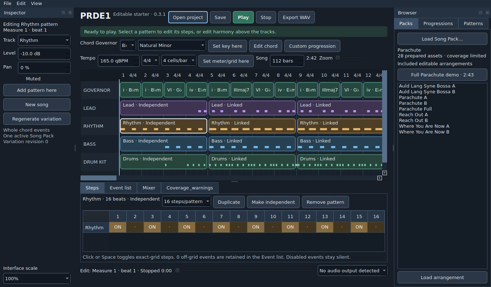

# PRDE1 — Pop Rock Development Environment 1

Build **0.3.2** includes a **full-length Parachute demo: 2:42.91**, with an intro,
verses, pre-choruses, recurring chorus hook, bridge, final chorus and outro. The
native graphical editor now ships four Song Packs and nine editable arrangements.
The Chord Governor selects prepared samples;
harmonic changes never pitch-shift or stretch audio during playback.

Version 0.3.2 fixes boundary clicks with a 1 ms safety fade at sample starts and
a smooth 5 ms release. Existing installations automatically receive the new
renderer after pulling. [Boundary behavior and evidence](docs/SAMPLE_BOUNDARIES.md)
explain the sampler fix.

This is a development build. Recording/comping, full DSP, VST hosting, complete
catalogs, and a real-time native device engine remain approved work. The desktop
auditions a background-rendered version of the arrangement through Qt Multimedia.
Pack listening and reference-device testing remain open; see
[the checkpoint](docs/CHECKPOINT.md).

The [live SDD](https://docs.google.com/document/d/1qb6LWTgkk3vVJB3aFnwkXvtZ1-IxRIY0VezW0P9e_HE/edit)
is the canonical product/design authority.

## Launch the desktop

From your existing repository folder:

```bash
git pull --ff-only origin main
./run-prde1.sh --project packs/parachute_full.prdeproj
```

First launch installs PySide6 into a local virtual environment if it is absent.
That setup needs an internet connection; the installed composer then operates
offline without an API key. The launcher restores the verified compiled renderer
from the pulled build parts, replacing an older executable when needed. Python 3.11+ is required. On Ubuntu/Linux
Lite, a missing virtual-environment or X11 cursor dependency can be installed with
`sudo apt install python3-venv libxcb-cursor0`.

Press **Play** to hear the full Parachute demo. It is an ordinary editable
112-bar project at 165 BPM. The Browser → Packs button **Full Parachute demo ·
2:43** also opens it from an existing session. [The score and section timings](docs/PARACHUTE_DEMO.md)
describe its form. Select a pattern in the timeline and click its
steps to edit. **Edit chord** and **Custom progression** change harmony; **Save**
writes a native project and **Export WAV** creates the stereo mix. The Browser
loads all nine included arrangements. [Desktop controls](docs/DESKTOP.md)
explain the remaining controls and current boundaries.



## Compiled distribution and command-line auditions

The distribution in `dist/PRDE1_0.3.2_Linux_x86_64.tar.gz` contains the desktop code, a compiled
Linux x86_64 renderer, Python control code, four packs, nine projects and nine
ready-rendered WAV auditions. Git stores bounded `.partNN` files with hashes;
restore the single archive from the checkout with:

```bash
python3 tools/assemble_build.py
tar -xzf dist/PRDE1_0.3.2_Linux_x86_64.tar.gz
cd PRDE1_0.3.2_Linux_x86_64
./run-prde1.sh --project packs/parachute_full.prdeproj
```

For command-line regeneration of the included auditions, run:

```bash
./run-demos.sh
```

Python 3.11+ is required. The supplied binary was built/tested on Ubuntu 24.04
x86_64; rebuild with `make all` on other supported Linux systems. No source
preparation packages, model downloads or network access are needed to play
these prepared packs. This is not a tested Steam Deck installer.

From a source checkout, GNU Make and a C++20 compiler are also required:

```bash
make check
make source-demo
```

Open `out/source-auditions/*.wav`. Each four-bar arrangement has different harmony,
tempo or variation settings; Parachute Full adds the complete song form. All nine
exports use actual source assets and need
no altered-render approval.

| Song Pack | Source sound and demonstrations |
| --- | --- |
| Reach Out (Stems) — spinningmerkaba | Acoustic whole chords, electric guitar lead, low bass; B natural minor and D major |
| Where You Are Now — Benjamin Orth / WolfFly | Credited Rhiannon vocal, synth pad and bass; C natural minor and C Dorian |
| Auld Lang Syne (Bossa) — unreal_dm | Melodic lead, piano triads/sevenths and hand percussion; F major and D natural minor |
| Parachute — Shael Riley | Sampled lead vocal, native whole guitar chords and bass; B-flat natural minor and B-flat harmonic minor |

The first three packs are **CC BY 3.0**. Parachute retains **Shael Riley's user
authorization and Suno paid-account rights declaration**, with no CC grant
implied. Credits and changes are recorded inside each pack. Code is MIT.
[Source credits, coverage and preparation](docs/SONG_PACKS.md)
identify every ingredient and the remaining listening checks.

## Edit, validate and render

```bash
python3 -m prde1 validate-pack packs/reach_out.prdepack
python3 -m prde1 rank packs/reach_out.prdepack --tonic 11 --mode natural_minor
python3 -m prde1 resolve packs/reach_out.prdepack packs/reach_out_a.prdeproj out/events.json
python3 -m prde1 render packs/reach_out.prdepack packs/reach_out_a.prdeproj out/edited.wav
python3 -m prde1 save-project packs/reach_out_a.prdeproj out/reopened.prdeproj
python3 -m prde1 render packs/parachute.prdepack packs/parachute_a.prdeproj out/parachute.wav
python3 -m prde1 render packs/parachute.prdepack packs/parachute_full.prdeproj out/parachute_full.wav
```

Project JSON preserves exact pack references, harmony, rational event timing,
quarter-note tempo maps, gates, variation seed, gain/pan and compressor state.
Explicit qualities and inversions are distinct. Governor segments do not snap
performance timing. Missing sounds block ordinary export; `resolve` reports
conflicts and natural sample-duration limits. Unsupported active effects or
vocal processing also block export. Explicit `--approve-altered-render` permits
reported missing material or unsupported VST instrument placeholders to remain
silent. It is unnecessary for the nine included arrangements.

Add `--seek-frame 123457` to `render` to reconstruct state from the beginning.
For this engine, the rendered result equals the corresponding full-render slice,
including compressor and dither state. This is not a promise for future plug-ins.

`make demo` retains the two explicitly synthetic regression fixtures. They prove
core behavior and are separate from the four actual-source packs.

`make cc-demo` remains an alias for `make source-demo`.

Application code: MIT. Dependencies/content retain their terms;
see [components](docs/COMPONENTS.md) and [remaining scope](docs/DEVELOPMENT_PLAN.md).
