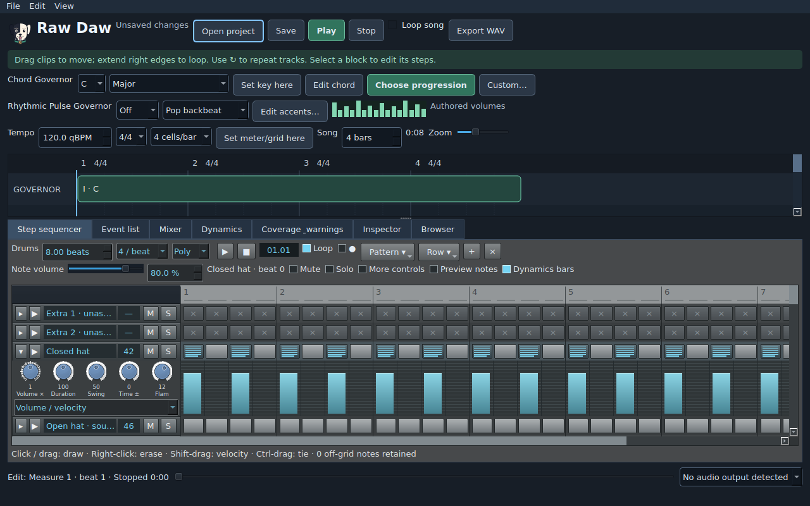

# Default step sequencer

The Step sequencer tab is the default pattern view for bass, lead and drum kits.
Select a pattern on the timeline, or select its track in Inspector: the pattern
under the edit cursor opens automatically. Bass/lead rows name their MIDI pitches;
kit rows retain their stable instrument identities. Pitch cells outside the
current chord are visibly marked. Section 31 of the canonical SDD records Shael's
October 11 request, including his clarification that he means the step sequencer.

## SONAR reference interface — October 14

The supplied SONAR/Cakewalk screenshot guides the native Qt interface: silver
beveled step buttons, cyan active hits, numbered beat groups, cream playback
highlighting, a compact transport and an inline expression editor. Each row has
an expand arrow, an audition button, its MIDI address and M/S buttons. Clicking
the name focuses the row; ▶ auditions it. Mute and Solo target the clicked row,
remain saved with the pattern and are undoable. Unassigned kit addresses show —.

The focused row expands beneath its step buttons. Its left inspector exposes
Volume ×, Duration, Swing, Time ± and Flam dials, with an expression selector;
the bars occupy the same time columns as the steps. Mouse gestures commit one
undoable change on release. The expression panel follows vertical/horizontal
scrolling and collapses through the row arrow or **Dynamics bars**. Exact numeric
row controls remain available through **More controls**. Shared painted headers
and a cell delegate avoid creating a widget per step or per available pitch.

The pattern transport provides ▶, ■, Loop and a beat/subdivision readout. The ●
switch enables keyboard step entry. Mono/Poly and Follow/Exact retain the same
saved musical semantics. Row +/× provide insert/delete shortcuts. Pattern and Row
menus retain reuse, interchange, fill and editing commands.

## Composition controls

Focus a note and use the visible **Note volume** slider or percentage field to
set its individual level from 0–100%. Volume is saved as note velocity and applies
before row dynamics and mixer levels. The tooltip also shows its MIDI velocity
on the 0–127 scale. A slider drag creates one undoable edit. A tied note can be
edited from any of its sustained cells without creating another attack.

**Dynamics bars** are visible by default for the focused pitch or kit row. Drag
each note's bar to shape its volume; empty columns remain empty. **More controls**
opens new-note defaults, the other expression types and row timing.
The event list/dialog exposes **Note volume** for exact off-grid notes.
Values survive save/reopen, pattern reuse, undo/recovery, preview and audio export.
Silent realized notes are omitted from MIDI export rather than becoming faint
velocity-one hits. Percentages describe amplitude, not a decibel or loudness scale.

| Control | Behavior |
| --- | --- |
| Left-click / drag | Toggle the first step; dragging paints or erases consistently from that initial state; fast drags fill crossed columns |
| Right-click / drag | Disable steps without deleting their authored data |
| Arrows + Space | Navigate and toggle the focused step |
| Mono / Poly entry | Replace other notes in a column, or retain simultaneous notes; bass/lead default mono, kit defaults poly |
| Follow harmony / Lock pitches | Choose the behavior of new melodic notes; existing notes retain their individual lock settings |
| Pattern beats / Steps per beat | Set length and resolution; resolution changes preserve exact existing timing |
| Shift-drag | Change the clicked step's velocity |
| Ctrl-drag / Row → Tie | Merge adjacent steps into a held note; Ctrl-right-drag / Split restores separate attacks |
| Double-click | Toggle a quieter flam grace trigger |
| Expression bars | Draw velocity, gate duration, play/change probability or timing offsets; one drag is one undo operation |
| Note volume | Slider and percentage for the focused note; Shift-drag and default dynamics bars provide gesture alternatives |
| More controls | New-note volume, expression type, row velocity multiplier/offset, gate %, swing %, time offset %, flam timing |
| Row menu | Insert/delete/rename/reorder, copy/cut/paste, shift, reverse, clear and fill every N steps |
| Alt-left/right | Shift the focused row by one step, wrapping within the pattern |
| Alt-up/down | Move a melodic column to the next higher/lower permitted pitches |
| Pattern menu | Save/load, clear, explicit quantize, Fit to quarters, duplicate, linked/independent reuse and MIDI interchange |
| Play pattern / Loop | Audition the selected pattern independently of the song transport |
| Row ▶ / row name | Audition that pitch/instrument / focus the row without changing the song |
| Preview notes | On initially; hear mouse press/drag and keyboard entries, with a saved preference for quiet editing |
| Step entry | Use Space or Z S X D C V G B H N J M; period advances/rests, comma goes back; Ctrl-R toggles entry |

Active cells use cyan stripes and a small velocity bar; exact percentages are
available in Note volume and tooltips. `F` marks a flam;
a cyan line marks a continuation of an earlier note. Scroll vertically for additional
pitches and horizontally for longer patterns. The highlighted playback column
follows the real preview clock, including independent looped auditions.

Rows offer native or source-derived kit sounds. Empty optional extras stay
unassigned. Source-specific Extra 1/2 names remain visible. The focused row’s expression editor opens initially. The visible
More controls toggle and menus provide numeric and non-drag equivalents. The exact Event list remains an
editable alternative and retains every off-grid event.

## Musical and persistence rules

Row settings are saved in an optional `step-v1` pattern extension; existing saves
and source patterns retain their original behavior until edited. All edits use
the same transactional project validation, bounded undo history, recovery and
native render path. Explicit linked copies share edits; ordinary copies remain
independent. The loader still verifies the exact immutable Song Pack.

Swing 50% is straight; 66.67% is approximately a 2:1 shuffle. Row timing offsets
wrap inside the pattern. New entries must be chord-compatible at their column;
the Governor checks shifted/repeated/flammed attacks again at the actual trigger
position. A follow-harmony note adapts by chord tone and chosen register; a locked
incompatible pitch remains a visible authored conflict. Deleted display rows do
not silently erase harmony-following notes when later harmony moves their pitch.

Flams use a quieter grace trigger at 45% of the primary velocity and share its
probability outcome. At beat zero, a forward flam leaves the grace at zero and
delays the primary; negative flam spacing puts the grace after the primary and
wraps it at the pattern boundary. Ties remove intervening same-row attacks;
ordinary drum samples retain their natural one-shot duration. Harmonic-boundary
fades and deliberate mutes/solos, probability skips and disabled steps remain.

Optional melodic polyphony uses concurrent voices already supported by the native
engine. Mono patterns retain one voice per lane; existing hat choke and fixed DSP
routing remain. Full voice/resource bounds are validated rather than stealing
voices silently. A pattern-length edit cannot discard existing notes or overlap
another placed pattern on its track. Fit to quarters explicitly scales timing;
custom spacing is displayed precisely. Quantize is a separate undoable command.

Pattern audition isolates one pattern and its local harmony/tempo. Row audition
uses a separate compatible audition context. Neither operation changes the song,
its variation seed/revision, credits or undo history. Scope-specific preview keys
cannot be confused with full-song exports; stale jobs remain cancelable on edits.

Live entry preview has its own playback path and does not start or loop the song.
It uses the chosen pitch, whole chord or kit sound and its note/row/mixer volume.
Mouse previews can sound before the gesture commits; dragging still produces one
undo operation. Keyboard entry previews each enabled note. Changing the focused
note's volume also auditions the revised level. Erasing stays quiet.

Entry preview temporarily auditions the primary sound with play probability 100%
and variation Off; those values never replace saved probabilities or variation.
Row/channel mutes, zero level and harmonic eligibility still apply. Previews start
immediately in their clip and use the authored gate, capped at two seconds. The
first use prepares a short native clip; repeated sounds reuse a bounded cache and
preloaded Qt effects. Rapid input selects the latest note instead of building a
delayed queue. Stop, disabling Preview notes, changing harmony/pack and closing
cancel stale work. The switch is an application preference, separate from the
musical project. Physical-device latency and listening remain unverified.

## Pattern and MIDI interchange

`.prdepattern` files preserve steps, expression, row settings, source reference
and attribution. Loading replaces the selected pattern, including linked uses,
through a validated undoable edit. Role mismatch is rejected. A kit pattern from
another pack requires deliberate identity remapping rather than hidden swapping.

Import note MIDI reads bounded PPQ SMF 0/1 note events, retaining timing and
velocity under the current song tempo/harmony. Pitched notes retain exact locks;
overlapping notes select polyphony. Kit import recognizes pack addresses and
standard core drum addresses, and asks for explicit mapping of other notes.
Rhythm import coalesces simultaneous chord-note attacks into one whole-chord
trigger, with the longest constituent gate. Source MIDI tempo/controller curves
do not overwrite the current song. No MIDI is executed and SysEx is not sent.

Export note MIDI writes the resolved musical performance at 960 PPQ, including
row expression, swing/flams, saved probabilities, note gates and tempo metadata.
Rhythm chord pitches expand into note-level events; kit hits retain the pack's
MIDI addresses on channel 10. MIDI velocity excludes mixer/sample gains. Reused
same-pitch addresses get an explicit note-off before their next note-on. This
interchange does not include the stereo mix, vocals or full project state.

General effect/controller automation, external MIDI-device capture and arbitrary
MIDI-output routing are separate integrations. The current step-entry workflow
uses the computer keyboard and MIDI files. Approved recording/VST scope remains.
The existing physical Steam Deck startup issue is not closed by these UI tests.

## Validation and references

Musical tests cover pitch/kit dispatch, mono/poly scheduling, gating and velocity,
mute/solo, swing/flams and shared probability, harmonic revalidation after shifts,
ties, row reuse, save/reopen, MIDI interchange, source immutability and native
repeat/seek. Real Qt tests draw/erase, tie and enter notes, adjust expression,
audition loops/rows, select tracks and exercise custom Fit spacing. Existing
responsive/startup, all twelve GUI exports and complete chord-coverage tests
remain part of `make check`; `make demo` retains both reference arrangements.

Cakewalk's primary references informed the interaction vocabulary:
[menus](https://legacy.cakewalk.com/Documentation?product=SONAR&language=3&help=Views.14.html),
[toolbar](https://legacy.cakewalk.com/Documentation?product=SONAR&language=3&help=Views.15.html),
[rows](https://legacy.cakewalk.com/Documentation?product=SONAR&language=3&help=Views.16.html),
[notes pane](https://legacy.cakewalk.com/Documentation?product=SONAR&language=3&help=Views.17.html).
This is an original PRDE1 implementation with its own interface and constraints.
